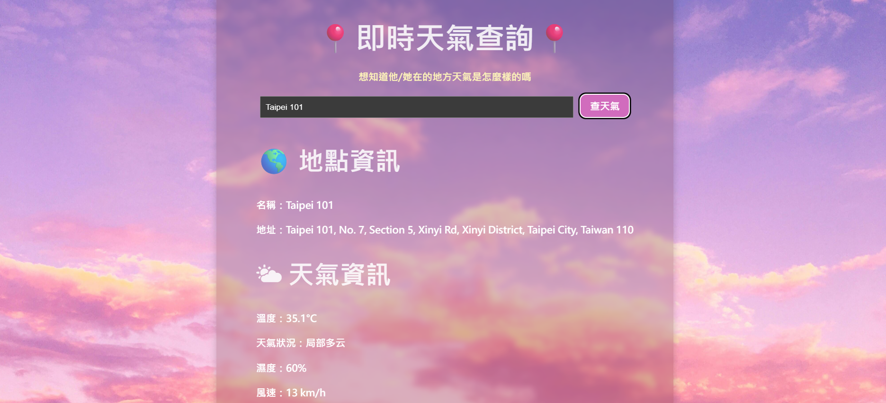

# **🌍 Weather Map App**
> **Django + Vue 前後端分離應用，結合 Google Places API 與 Weather API 查詢地點與天氣資訊。**

## **📖 專案簡介**
此專案使用 **Django 後端 API** 搭配 **Vue 前端**，讓使用者輸入地點名稱，即可查詢：
- **地點資訊**（Google Places API）
- **即時天氣**（Weather API）
- **前端即時顯示查詢結果**

**架構：Django (REST API) + Vue (前端) + Vite (開發環境)**

---

## **📌 目標**
開發一個 **地點與天氣 API 應用**，提供：
1. **地點查詢**（Google Places API）
2. **即時天氣資訊**（Weather API）
3. **前後端分離設計**

---

## **📌 技術棧**
1. **後端**：Django REST Framework  
2. **前端**：Vue 3 + Vite  
3. **API 整合**：
   - Google Places API（地點查詢）
   - Weather API（天氣查詢）
4. **部署方式**
   - 本地開發：Django runserver + Vite
   - 部署：(尚未)

---

## **🔧 安裝與使用**
### **1️⃣ clone 此專案**
```bash
git clone https://github.com/MichellellehciM/location-explorer.git
cd location-explorer
```

### **2️⃣ 設定後端（Django）**
```
cd backend
poetry install
```

### **3️⃣ 設定後端（Django）**
```
GOOGLE_MAPS_API_KEY=
WEATHER_API_KEY=
```

### **4️⃣ 啟動 Django 伺服器**
```bash
poetry run python manage.py migrate
poetry run python manage.py runserver
```

### 5️⃣ **設定前端(Vue)**
```bash
cd frontend
npm install
npm run dev
```
Vue 伺服器運行 http://localhost:5173/

### **測試**
讓使用者輸入地點名稱（如：台北101、高雄85大樓），點擊「查天氣」按鈕

